<h1 align="center">Pokedex</h1>

<p align="center">
  A Pokedex for iOS and Android built with Expo and React Native.<br />
  Catch Pokémon with a thrown Poké Ball, browse all 1025 of them, and keep everything you have seen available offline.
</p>

<p align="center">
  
  
  
  
</p>

<p align="center">
  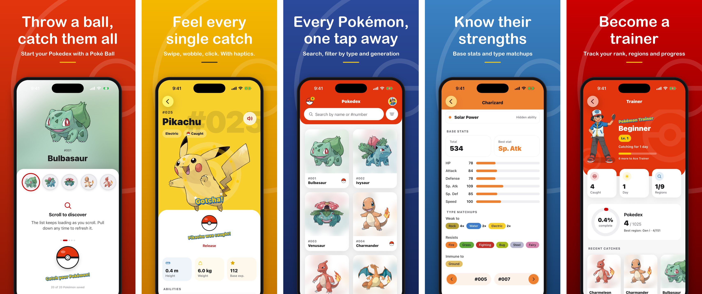
</p>

## Table of contents

- [Demo](#demo)
- [Features](#features)
- [Getting started](#getting-started)
- [Scripts](#scripts)
- [Architecture](#architecture)
- [Project structure](#project-structure)
- [How data is consumed](#how-data-is-consumed)
- [Offline and caching](#offline-and-caching)
- [Error handling](#error-handling)
- [State management](#state-management)
- [UI, motion and haptics](#ui-motion-and-haptics)
- [Accessibility](#accessibility)
- [Code quality and tooling](#code-quality-and-tooling)
- [CI/CD](#cicd)
- [Technical decisions](#technical-decisions)
- [Libraries](#libraries)
- [Roadmap](#roadmap)

## Demo

<p align="center">
  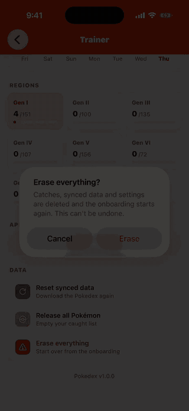
</p>

<p align="center"><sub>Shown at 3x speed. Full video: <a href="docs/demo/pokedex-demo.mp4"><code>docs/demo/pokedex-demo.mp4</code></a> (98 s, 720p).</sub></p>

It covers the paced onboarding download, the Poké Ball throw and hand-off to the home screen, search, catching Pikachu from its detail, previous / next, the caught list and the trainer profile.

### Screenshots

<table>
  <tr>
    <td>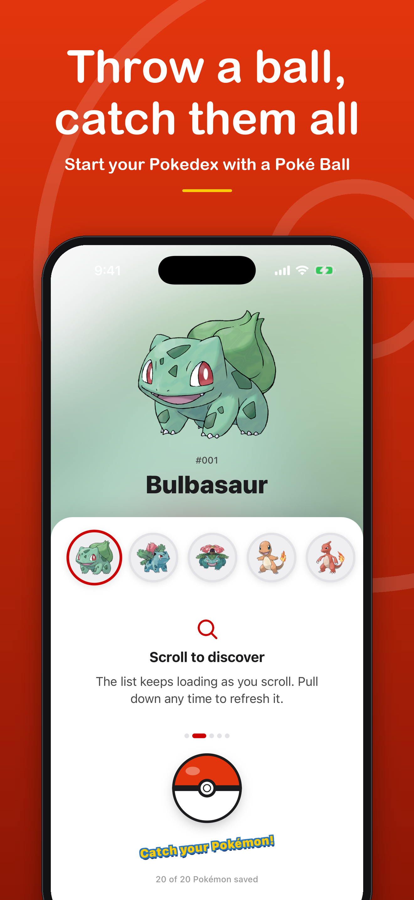</td>
    <td>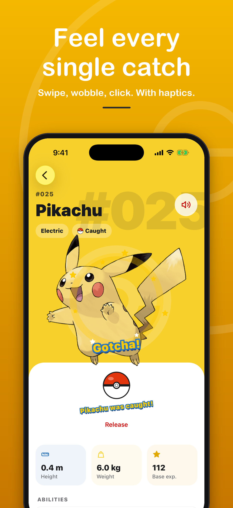</td>
    <td>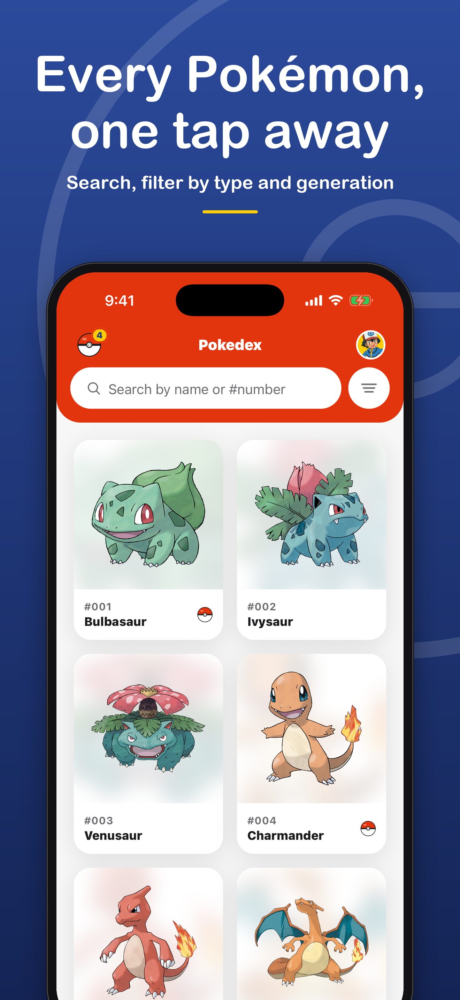</td>
    <td>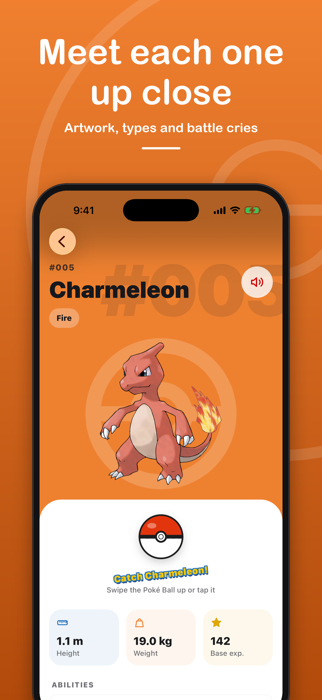</td>
  </tr>
  <tr>
    <td>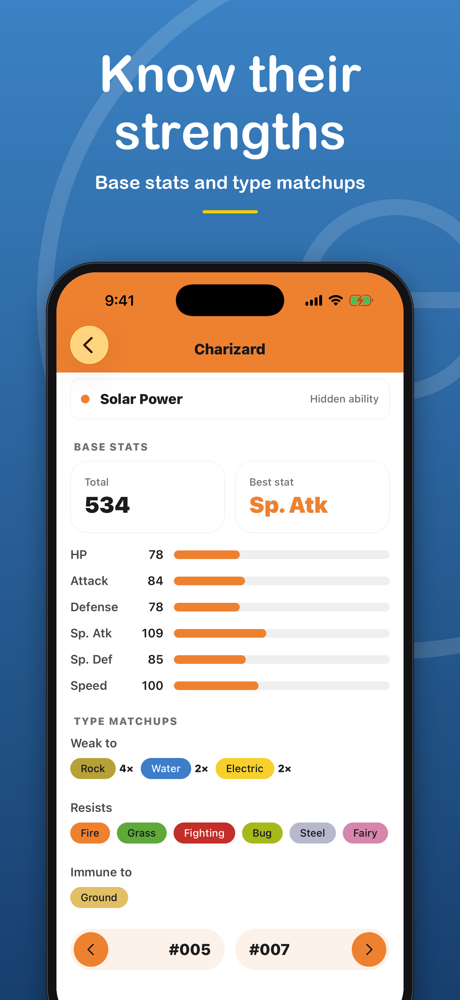</td>
    <td>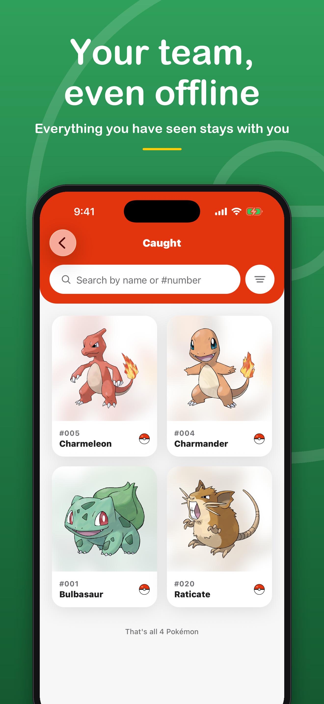</td>
    <td>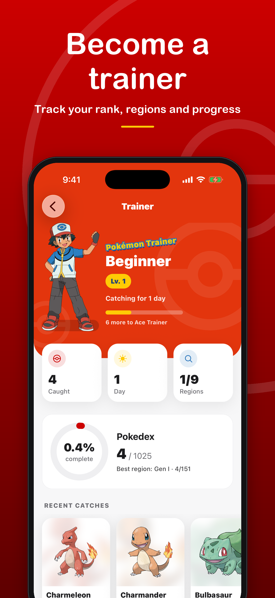</td>
    <td></td>
  </tr>
</table>

Store-ready versions (advertisement style, one idea per screen):

| Store                   | Size      | Folder                                     |
| ----------------------- | --------- | ------------------------------------------ |
| App Store (iPhone 6.9") | 1320x2868 | [`docs/store/ios`](docs/store/ios)         |
| Google Play (phone)     | 1080x2400 | [`docs/store/android`](docs/store/android) |

## Features

**Browse**

- Infinite list of every Pokémon (pages of 20), pull to refresh, loading skeletons.
- Instant search by name or Pokedex number.
- Filters by generation and by type, combined with the search.

**Catch**

- First-launch onboarding that downloads the first 20 Pokémon while you throw a Poké Ball at the featured one.
- Catch any Pokémon from its detail screen: swipe the ball up (or tap it), watch it wobble three times and click shut.
- Caught list, release one or all, and a trainer profile with rank, completion ring and catch charts.

**Detail**

- Hero painted in the main type's color, giant dex number, floating artwork with parallax.
- Height, weight, base experience, abilities, base stats and type matchups (weak to, resists, immune to).
- Battle cry, downloaded on first play and available offline afterwards.
- Previous / next navigation between neighbouring entries.

**Offline and resilience**

- Everything already seen opens without a connection; data refreshes silently in the background.
- Explicit states for no connection, server errors, timeouts, missing images, failed resets and unexpected crashes. See [Error handling](#error-handling).

**Feel**

- Haptic feedback on throws, wobbles, catches, releases and selections.
- Light, dark and system themes, native SF Symbols on iOS, "reduce motion" respected everywhere.

## Getting started

| Tool     | Version                        |
| -------- | ------------------------------ |
| Node.js  | 22.13+ or 24.3+ (see `.nvmrc`) |
| pnpm     | 10+                            |
| Expo SDK | 58                             |

The app uses native modules that Expo Go does not bundle (`react-native-audio-api`, `expo-glass-effect`), so it runs in a **development build**.

```bash
nvm use
pnpm install        # also registers the git hooks (Husky); npm and yarn are blocked
```

```bash
pnpm ios            # build and run on the iOS simulator
pnpm android        # build and run on an Android emulator or device
pnpm start          # start only the dev server (after a development build is installed)
```

> Cocoapods can fail with `Unicode Normalization not appropriate for ASCII-8BIT`. Run the command with `LANG=en_US.UTF-8` to fix it.

## Scripts

| Script              | Description                                  |
| ------------------- | -------------------------------------------- |
| `pnpm lint`         | Run ESLint on the whole project              |
| `pnpm lint:fix`     | Run ESLint with autofix                      |
| `pnpm format`       | Format with Prettier                         |
| `pnpm format:check` | Check formatting without writing             |
| `pnpm typecheck`    | Type-check with `tsc`                        |
| `pnpm validate`     | `typecheck` + `lint` + `format:check`        |
| `pnpm doctor`       | Diagnose dependency and config issues (Expo) |

## Architecture

Clean Architecture with ports and adapters. Business rules sit in the center and know nothing about React, `fetch` or PokéAPI; everything else plugs into them through interfaces. Dependencies only point inward, and ESLint (`import/no-restricted-paths`) fails the build when a layer imports something it should not.

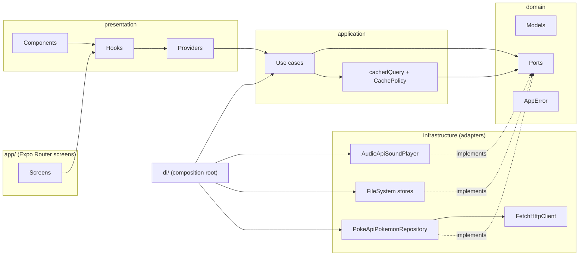

| Layer            | Folder               | Contains                                                          | May import              |
| ---------------- | -------------------- | ----------------------------------------------------------------- | ----------------------- |
| Domain           | `src/domain`         | Models, enums, types, ports (interfaces), `AppError`              | nothing                 |
| Application      | `src/application`    | Use cases and the cache policy: validation and orchestration      | domain                  |
| Infrastructure   | `src/infrastructure` | HTTP client, PokéAPI repository, DTOs, mappers, storage and audio | domain                  |
| Presentation     | `src/presentation`   | Providers, hooks, atomic components, theme, UI copy               | domain, application, di |
| Composition root | `src/di`             | Builds adapters and use cases, exposes them through React context | everything              |
| Routes           | `src/app`            | Expo Router screens; thin, they connect hooks to components       | presentation, di        |

Full description, data flow and component catalog: [docs/architecture.md](docs/architecture.md).

## Project structure

```
src/
  app/                       Expo Router routes (each file is a screen)
    _layout.tsx              Providers, stack, root ErrorBoundary
    index.tsx                Pokedex list
    onboarding.tsx           First-launch catch flow
    caught.tsx               Caught Pokémon
    profile.tsx              Trainer profile and settings
    pokemon/[id].tsx         Pokémon detail
    +not-found.tsx           Unknown address
  domain/
    models/                  PokemonSummary, PokemonDetail, PokemonStat, PokemonAbility
    enums/                   PokemonType, StatName, DataSource
    types/                   Page, PageRequest, Cached
    ports/                   PokemonRepository, CacheStore, MediaCache, SoundPlayer
    errors/                  AppError, ErrorKind, toAppError
  application/
    cache/                   CachePolicy (5-day TTL), cachedQuery (stale-while-revalidate)
    use-cases/               GetPokemonPage, GetPokemonDetail, GetPokemonIdsByType,
                             PlayPokemonCry, ClearSyncedData
  infrastructure/
    http/                    FetchHttpClient: timeout, retries, cancellation, error mapping
    pokeapi/                 PokeApiPokemonRepository, dtos/, mappers/, config
    storage/                 FileSystemCacheStore, MemoryCacheStore, media caches
    audio/                   AudioApiSoundPlayer
  presentation/
    providers/               Theme, network, onboarding, caught, pokemon data (list + details)
    hooks/                   usePokemonList, usePokemonDetail, usePacedReveal, usePokemonCry...
    components/              atoms/ molecules/ organisms/ (atomic design)
    theme/                   Palettes (light/dark), tokens, ThemeProvider
    errors/                  getErrorMessage: ErrorKind to user-facing copy
    utils/                   Formatters, search, type effectiveness, haptics, trainer stats
  di/                        createDependencies, DependenciesProvider, useDependencies
assets/                      Icons, splash, brand artwork
docs/                        Architecture, CI/CD, demo video, store screenshots
```

Naming: files in kebab-case; DTOs end in `.dto.ts`, mappers in `.mapper.ts`. Each folder exposes its public API through an `index.ts`.

## How data is consumed

All data comes from the public [PokéAPI](https://pokeapi.co/) (`https://pokeapi.co/api/v2`). No API key and no backend of our own.

| Endpoint                      | Used for                                                      | Mapped to                           |
| ----------------------------- | ------------------------------------------------------------- | ----------------------------------- |
| `GET /pokemon?offset=&limit=` | The paginated list (20 per page)                              | `Page<PokemonSummary>`              |
| `GET /pokemon/{id or name}`   | Detail: types, stats, abilities, size, cry                    | `PokemonDetail`                     |
| `GET /type/{type}`            | Ids of every Pokémon of a type, for the type filter           | `number[]`                          |
| `official-artwork` sprites    | High resolution artwork, served from the PokéAPI sprites repo | `imageUrl` (cached by `expo-image`) |
| `cries.latest`                | Battle cry audio (Ogg Vorbis), downloaded on first play       | file in the documents directory     |

### From a tap to the screen

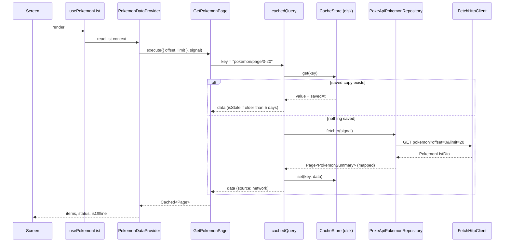

1. Screens read state through hooks; they never call use cases or `fetch` directly.
2. The provider gets use cases from `useDependencies()` and always passes an `AbortSignal`, so leaving a screen cancels its request.
3. The use case validates its input and resolves data through `cachedQuery`: saved copy first, network when needed.
4. The repository returns a **DTO** (PokéAPI's snake_case shape) which a **mapper** converts into a domain model (camelCase, metres and kilograms, typed enums). The rest of the app never sees a DTO.
5. Every failure becomes an `AppError` with an `ErrorKind`; the UI turns it into copy with `getErrorMessage`.

### HTTP client

`FetchHttpClient` wraps the native `fetch`, with no HTTP library.

| Feature      | Behavior                                                                                                |
| ------------ | ------------------------------------------------------------------------------------------------------- |
| Defaults     | `baseUrl`, `Accept: application/json`, 15 s timeout, 2 retries, 300 ms base delay                       |
| Timeout      | Own `AbortController`; reported as `ErrorKind.Timeout`                                                  |
| Cancellation | External `AbortSignal` is forwarded; reported as `ErrorKind.Cancelled` and never retried                |
| Retries      | Idempotent methods only, on network errors, timeouts, 5xx and 429, with exponential backoff             |
| Responses    | JSON or text from `Content-Type`; empty bodies return `undefined`                                       |
| Errors       | Always `AppError`: `Network`, `Timeout`, `Cancelled`, `NotFound`, `Client`, `Server`, `InvalidResponse` |

Adding an endpoint means adding a DTO, a mapper and one repository method. The client does not change.

### Background sync

After the first page loads, the provider saves the **detail and artwork of every listed Pokémon** quietly (two at a time, fresh entries skipped, stopping at the first connectivity error). The onboarding shows that progress, and later the detail screen opens instantly, even offline.

## Offline and caching

The goal: open instantly with saved data, work without a connection for everything already seen, and stay up to date without spinners or prompts.

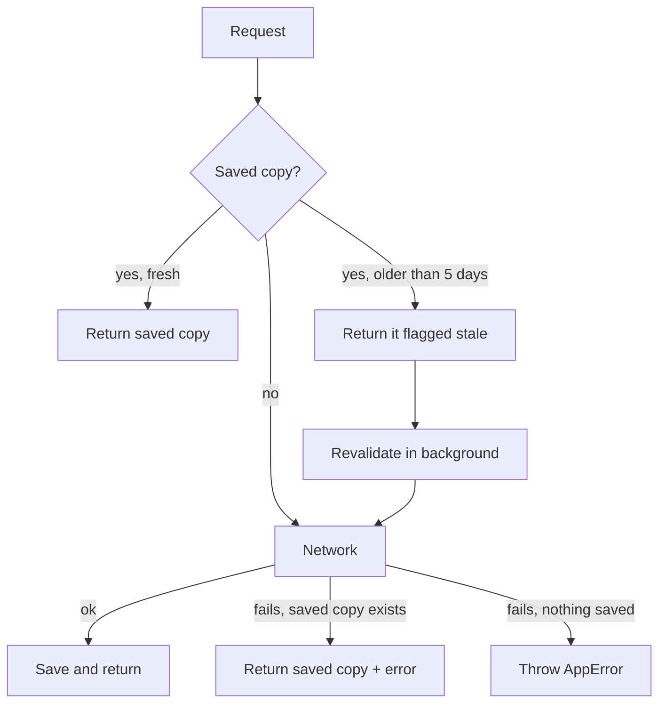

| Piece           | Behavior                                                                                                               |
| --------------- | ---------------------------------------------------------------------------------------------------------------------- |
| Storage         | `FileSystemCacheStore`: one JSON file per key in the documents directory (not purged by the OS), in a versioned folder |
| Freshness       | `CachePolicy` with a **5-day TTL**: fresh data never touches the network                                               |
| Stale data      | Served immediately, flagged `isStale`, refreshed silently                                                              |
| Network failure | Saved data of any age is shown with a quiet "Offline - showing saved data" banner; it is never discarded               |
| Reconnection    | A silent retry every 30 s while offline with data on screen, and when the app returns to the foreground                |
| Images          | `expo-image` with `cachePolicy="memory-disk"`: artwork seen once is available offline                                  |
| Cries           | Downloaded only when the user taps play (never by the prefetch), then stored on disk                                   |
| Reset           | Profile -> "Reset synced data" clears the JSON cache, the media cache and the image cache, then downloads again        |

Connectivity is inferred from request results plus `expo-network`, so a failed request is the signal that matters.

## Error handling

Every failure has a place on screen and a way out.

| Situation                                  | What the user sees                                                                 | Recovery                   |
| ------------------------------------------ | ---------------------------------------------------------------------------------- | -------------------------- |
| First launch, no internet                  | Full screen "Internet required"                                                    | **Try again**              |
| First launch, PokéAPI fails or times out   | Full screen "Couldn't download your Pokedex" with the specific reason              | **Try again**              |
| List fails with nothing saved              | Status message with the reason                                                     | **Try again**              |
| Offline with saved data                    | Quiet banner with the age of the data, plus a snackbar when the connection changes | Automatic silent retry     |
| Detail fails to load                       | Status message ("You're offline" or "Couldn't load this Pokémon")                  | **Try again**              |
| Artwork cannot be downloaded or found      | A Poké Ball placeholder in place of the image                                      | Loads again with a new URL |
| Cry fails, or offline and never downloaded | The cry button shows an error state or a disabled hint                             | Tap again                  |
| Type filter cannot load                    | Inline message under the filters                                                   | Change or retry the filter |
| "Reset synced data" fails                  | Alert explaining what happened, error haptic                                       | Run it again               |
| Unknown route or stale deep link           | "This page doesn't exist"                                                          | **Back to the Pokedex**    |
| A screen throws while rendering            | Standalone crash screen (no providers, so it cannot crash again)                   | **Try again** remounts     |

The mapping from `ErrorKind` to copy lives in one file, `src/presentation/errors/get-error-message.ts`.

## State management

React Context and `useReducer`; no state library.

| Context                 | Holds                                                         | Consumed through       |
| ----------------------- | ------------------------------------------------------------- | ---------------------- |
| `ThemeContext`          | Active theme and the user's preference                        | `useTheme()`           |
| `NetworkContext`        | Device connectivity                                           | `useNetwork()`         |
| `OnboardingContext`     | Whether onboarding is done, and the hand-off to the home ball | `useOnboarding()`      |
| `CaughtContext`         | Caught Pokémon, persisted on disk                             | `useCaught()`          |
| `PokemonListContext`    | Pages, pagination, loading, refresh and offline flags         | `usePokemonList()`     |
| `PokemonDetailsContext` | Detail entries by id and the ids saved for offline use        | `usePokemonDetail(id)` |

List and details live in separate contexts so loading a detail never re-renders the list. Each is driven by a reducer (`list-reducer.ts`, `details-reducer.ts`), so every transition is explicit and testable without rendering.

## UI, motion and haptics

- **Atomic design** from React Native primitives: `atoms` -> `molecules` -> `organisms`. Icons are an own SVG set (`react-native-svg`) so they look identical on both platforms.
- **Poké Ball throw** (`PokeballLauncher`): React Native `Animated` plus responder events. The ball flies to the Pokémon, opens, pulls it in, wobbles three times, clicks shut and, in the onboarding, grows into a full-screen ball that the home screen splits open. It is rebuilt from plain views while growing so it never pixelates.
- **Detail hero**: the artwork is drawn in a layer **above** the white sheet, so parallax, the catch bounce and the celebration are never covered by it.
- **Paced onboarding**: Pokémon that are already saved still appear one at a time (`usePacedReveal`), so a warm cache never makes the screen snap into place.
- **Haptics** (`expo-haptics`, wrapped in `src/presentation/utils/haptics.ts`):

| Moment                         | Feedback             |
| ------------------------------ | -------------------- |
| Ball leaves the hand           | Medium impact        |
| Ball opens                     | Medium impact        |
| Ball closes                    | Heavy impact         |
| Each of the three wobbles      | Light impact         |
| The click: Pokémon caught      | Success notification |
| Release a Pokémon              | Warning notification |
| Chips, theme picker, prev/next | Selection tick       |
| A failed reset                 | Error notification   |

The helper is fire-and-forget and a no-op on the web, so a device without a haptic engine never produces an error.

## Accessibility

- Every interactive element has a role, label and, where useful, a hint. The Poké Ball can be activated without swiping.
- Touch targets are at least 44 pt; text scales with the system font size.
- Colors meet WCAG AA contrast in light and dark mode (the primary red is darkened in light mode for white labels).
- "Reduce motion" skips the throw animation, the paced reveal, skeleton shimmer and layout animations.

## Code quality and tooling

- **TypeScript** in strict mode, plus `noUncheckedIndexedAccess` and `noImplicitReturns`.
- **ESLint** (`eslint-config-expo` plus project rules): sorted imports, no `any`, no floating promises, hook dependencies, no import cycles, and layer boundaries.
- **Prettier** runs through ESLint, so there is a single source of formatting.
- **Husky + lint-staged + commitlint** check formatting, lint, commit messages and branch names before code leaves the machine.

Rules and workflow: [CONTRIBUTING.md](CONTRIBUTING.md).

## CI/CD

| Workflow                                                 | Trigger                  | Purpose                                                      |
| -------------------------------------------------------- | ------------------------ | ------------------------------------------------------------ |
| [CI](.github/workflows/ci.yml)                           | PR to `develop` / `main` | Quality checks and Android build                             |
| [Release PR](.github/workflows/release-pr.yml)           | Push to `develop`        | Opens or updates the `develop -> main` PR                    |
| [Android Release](.github/workflows/android-release.yml) | Push to `main`           | Builds the APK, tags `vX.Y.Z` and publishes a GitHub Release |
| [Dependabot](.github/dependabot.yml)                     | Weekly (Monday)          | Grouped dependency update PR to `develop`                    |

iOS builds are a work in progress. Details, cost decisions and required settings: [docs/ci-cd.md](docs/ci-cd.md).

## Technical decisions

| Decision                                    | Why                                                                                                                             |
| ------------------------------------------- | ------------------------------------------------------------------------------------------------------------------------------- |
| Clean Architecture (ports and adapters)     | Business rules are independent from React, `fetch` and storage; adapters can be swapped or faked in tests                       |
| Native `fetch` wrapped in `FetchHttpClient` | No HTTP library needed; timeout, cancellation, retries and error normalization in one place                                     |
| React Context + `useReducer`                | Enough for this app; no state library                                                                                           |
| File-based cache with a 5-day TTL           | React Native ships no storage API; `expo-file-system` is part of the SDK and JSON files fit small, read-mostly data             |
| Stale-while-revalidate                      | Instant screens, background refresh, no data lost when the network fails                                                        |
| DTO -> mapper -> domain model               | The API shape never leaks into the UI; a change in PokéAPI touches one mapper                                                   |
| Own SVG icon set                            | Unicode glyphs render differently per platform; `react-native-svg` is part of the SDK                                           |
| `react-native-audio-api` for cries          | PokéAPI serves Ogg Vorbis, which iOS cannot decode natively; this library decodes in native code on both platforms              |
| `expo-haptics` behind a tiny helper         | One place to tune feedback and to guarantee it never throws                                                                     |
| Artwork in a layer above the sheet          | z-order is decided among siblings, so the artwork is lifted out of the hero instead of fighting the sheet with negative margins |

## Libraries

| Package                                                                           | Use                                                             |
| --------------------------------------------------------------------------------- | --------------------------------------------------------------- |
| `expo-router`                                                                     | File-based navigation and route error boundaries                |
| `expo-file-system`                                                                | Persistent offline cache                                        |
| `expo-image`                                                                      | Remote images with disk cache and blurred backdrops             |
| `expo-haptics`                                                                    | Tactile feedback for throws, catches and selections             |
| `expo-network`                                                                    | Device connectivity                                             |
| `expo-symbols`                                                                    | Native SF Symbols on iOS, with SVG fallbacks                    |
| `react-native-svg`                                                                | The app's own icon set and the Poké Ball                        |
| `react-native-audio-api`                                                          | Decodes and plays Pokémon cries (Ogg Vorbis) on iOS and Android |
| `react-native-reanimated`, `react-native-gesture-handler`, `react-native-screens` | Navigation and gesture foundations                              |

Dev tooling (ESLint, Prettier, Husky, commitlint, `@expo/fingerprint`) is listed in [CONTRIBUTING.md](CONTRIBUTING.md) and [docs/ci-cd.md](docs/ci-cd.md).

## Roadmap

- iOS build in CI (WIP).
- The APK `versionName` comes from `app.json`; it is not synced with the release tag yet.
- Automated tests: unit tests for reducers, `cachedQuery`, mappers and `typeMatchups` are the natural first step.
- Cache size limit and cleanup of entries for Pokémon that are no longer listed.
- Evolution chains and moves on the detail screen.
